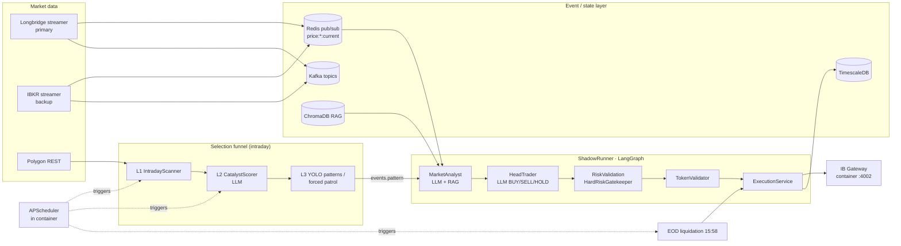
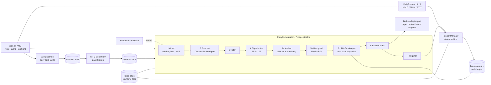

# Architecture Evolution: V11 → V12

This document summarizes how StockApp moved from the V11 architecture to V12, using
only what is recorded in this repository's docs, ADRs, changelog and the V11
reference snapshot in [`legacy/v11/`](../legacy/v11/README.md). Each section cites its
sources. No metrics are introduced here beyond those already stated in the cited docs.

---

## 1. V11 architecture

**Sources:** [`legacy/v11/docs/ARCHITECTURE.md`](../legacy/v11/docs/ARCHITECTURE.md),
[`legacy/v11/docs/TRADING_PIPELINE.md`](../legacy/v11/docs/TRADING_PIPELINE.md),
[`legacy/v11/docker/docker-compose.stock-app.yml`](../legacy/v11/docker/docker-compose.stock-app.yml),
[`legacy/v11/src/services/`](../legacy/v11/src/services/).

### 1.1 Components

| Area | V11 component(s) |
|------|------------------|
| Deployment | Multi-container Docker Compose stack on a single NUC host ("modular isolation" — each stack has private Redis, Kafka, TimescaleDB); the dev machine is used for editing and CI only |
| Broker / execution | IB Gateway container (IBC auto-login, paper mode) on port 4002; `ExecutionService` (idempotent) translates validated orders into IBKR API calls via `ib_insync` (`connection.py`, `execution_service.py`) |
| Market data / streaming | Longbridge streamer (primary) and IBKR streamer (backup, dedicated client id) publish to Redis pub/sub (`price:{symbol}:current`) and Kafka topics (`longbridge_realtime_streamer.py`, `ibkr_realtime_streamer.py`) |
| Selection funnel | L1 `IntradayScanner` (Polygon scan, pre-market + midday refresh) → L2 `CatalystScorer` (LLM-assisted) → L3 YOLO pattern / "forced patrol" (`selection/`, `pattern_*.py`) |
| Decision engine | `ShadowRunner` driving a LangGraph `StateGraph`: DataPrep → SuggestionConsumer → ExternalIntentConsumer → **MarketAnalyst (LLM)** → **HeadTrader (LLM BUY/SELL/HOLD)** → RiskValidation (`HardRiskGatekeeper`) → TokenValidator (cryptographic order token) → Execution |
| Scheduling | In-container APScheduler (`lifecycle_scheduler.py`), America/New_York, with ~12 daily jobs: scanners, macro research, causal distiller, EOD closing (15:45), **EOD liquidation (15:58)**, post-mortem, RAG integrity, heartbeat. (Earlier versions drove jobs from the dev machine via launchd → SSH → `docker exec`; V4.0 moved the scheduler into the container.) |
| Data | Kafka KRaft (event bus), Redis 7 (hot state, pub/sub), TimescaleDB (30-day hot window), Parquet cold storage, ChromaDB (RAG) |
| Learning loop | Post-mortem pipeline, reinforcement / RL services (Stable Baselines 3), trade recorder (`post_mortem_service.py`, `rl_service.py`, `reinforcement_service.py`) |
| Observability | Prometheus + Grafana, Redis audit streams, TimescaleDB decision log |

### 1.2 Data flow (V11)

---

## 2. Problems that motivated V12

**Sources:** [`SYSTEM_OVERVIEW.md`](SYSTEM_OVERVIEW.md) §2, §7, §8;
[`MIGRATION_GUIDE.md`](MIGRATION_GUIDE.md) (Phase 1–3 checklists);
[`superpowers/specs/2026-07-26-architecture-decoupling-upgrade-design.md`](superpowers/specs/2026-07-26-architecture-decoupling-upgrade-design.md) §1.2.

1. **Over-trading driven by intraday events.** `SYSTEM_OVERVIEW.md` names intraday
   pattern / YOLO-driven entries as the "V11 root cause of over-trading"; entries were
   triggered by an `events.pattern` storm. Its §7 table records V11 observations of
   ~430 decision events/day, 5–12 new entries/day, average holding period < 1 day and
   10+ concurrent positions.
2. **Risk configuration not fully enforced.** The same table records that V11's daily-loss
   limit differed between code (-5%) and YAML (-2%), and the single-position cap was 5%
   in code; §8 summarises V11 risk YAML as "partially ignored".
3. **Forced end-of-day flattening.** V11 liquidated at EOD (15:58 job), which conflicts
   with a multi-day swing thesis (Phase 2 of `MIGRATION_GUIDE.md` disables EOD liquidation).
4. **LLM in the decision seat.** In V11 the `HeadTrader` LLM node produced BUY/SELL/HOLD
   decisions ahead of the gatekeeper; V12 explicitly lists "black-box ML signal generation"
   as a non-goal and restricts the LLM to structured analysis.
5. **Infrastructure weight for the cadence.** V11 ran Kafka plus a multi-container stack;
   V12's non-goals include a distributed event bus "for daily jobs" as unnecessary
   complexity (`SYSTEM_OVERVIEW.md` §2, §8).
6. **Coupling (post-migration debt).** After the initial V12 cut, the decoupling spec lists
   remaining debts: runtime dependency on the V11 archive via `sys.path`, a "capability bag"
   `services/` package, `pipeline → services` reverse imports, an unwired `MarketDataClient`
   port, Redis used as a shared global DB without store ports, and `scripts/` as a second
   code plane. See also [`MIGRATION_DEBT.md`](MIGRATION_DEBT.md).

---

## 3. Key V12 design decisions and trade-offs

| Decision | What it means | Trade-off accepted | Source |
|----------|---------------|--------------------|--------|
| **Swing cadence, few scheduled jobs** | Daily scan (16:30), tier-2 step (08:00), entry window (09:35 then every 5 min to 15:30), daily review (16:15) | Gives up intraday opportunism; "most days 0 trades" is a goal | `SYSTEM_OVERVIEW.md` §1, `SCHEDULER.md`, `DEPLOYMENT.md` |
| **Single risk authority** | `RiskGatekeeper` is the sole entry authority; sizing comes only from risk budget and stop distance — `confidence` does not enter base sizing; LLM output cannot override it | Less "adaptive" sizing; simpler to audit and test | `SYSTEM_OVERVIEW.md` §4–5, `RISK_MANAGEMENT.md` |
| **7-stage entry pipeline** | guard → forecast → filter → signal rules (SR-01..07) → analyst → live guard (R-03/R-04) → gatekeeper → bracket → register | More stages to maintain; each stage has typed I/O and its own tests | `TRADING_PIPELINE.md`, `src/stockapp_v12/pipeline/stages.py` |
| **Fail closed** | Redis / broker / LLM / pre-eval failure ⇒ no new orders; failed daily review ⇒ HOLD | Missed trades on infra hiccups | `SYSTEM_OVERVIEW.md` §6 |
| **Mechanical exits, explicit lifecycle** | Stop-loss at entry, min hold, trailing, HOLD/TRIM/EXIT review; one write owner per position field | No EOD flat ⇒ overnight/gap exposure handled by broker stops | `POSITION_LIFECYCLE.md`, `SYSTEM_OVERVIEW.md` §5.1 (INV-1..7) |
| **System invariants as tests** | INV-1..7 and red-line rules R-01..R-10 have runtime checks + pytest coverage | Test suite grows with every rule | `SYSTEM_OVERVIEW.md` §5.1, `tests/` |
| **Redis + single host, no Kafka** | Production = cron on one NUC (WSL); Redis for state, counters, halt flags | No event replay bus; relies on journal/audit ledger instead | `SYSTEM_OVERVIEW.md` §8, `DEPLOYMENT.md` |
| **Append-only audit** | `TradeJournal` (RPUSH) and fsync'd audit ledger; journal never mutates state | Write amplification; storage growth | `MIGRATION_DEBT.md` MD-01/02, `CHANGELOG.md` |
| **Hexagonal modular monolith + Strangler** | Ports for Broker, MarketData, Chronos backend, Notifier, Clock, stores; V11 confined to `adapters/legacy_v11`; import boundaries enforced in CI; microservices deferred | Interim compatibility shims (`_v11_compat`, notifier shim) | [`ADR-011`](ADR-011-Hexagonal-Modular-Monolith.md), decoupling spec, `architecture/02-DECOUPLING-PLAN.md` |
| **Gate taxonomy** | Separate capital/position hard limits (L0), session halt (L1), path-change with human approval (L2) and diagnostics (D) | Daily trading uses only L0+L1; research gates no longer block trades | [`GATE_DECISION_ARCHITECTURE.md`](GATE_DECISION_ARCHITECTURE.md) |
| **Model promotion discipline** | Walk-forward evidence bars and a decision-vs-observation split before any model change | Slower model iteration | [`ADR-009`](ADR-009-WalkForward-Backfill-Addendum.md), [`ADR-010`](ADR-010-Post30Day-Training-and-Observation-Plan.md), `V3_LESSONS_AND_EXP_PLAN.md` |
| **Honest capability matrix** | Docs state which jobs are real vs stubs (e.g. tier-2 is a passthrough, trailing-stop cron disabled — broker SL only) | Exposes gaps instead of hiding them | [`PRODUCTION_CAPABILITIES.md`](PRODUCTION_CAPABILITIES.md), `DEPLOYMENT.md` |

### 3.1 V12 data flow

### 3.2 Side-by-side

| Area | V11 | V12 | Source |
|------|-----|-----|--------|
| Cadence | Intraday events (pattern poll, L3 patrol) | Few scheduled jobs per day | `SYSTEM_OVERVIEW.md` §8 |
| Holding | EOD force flat | Multi-day; SL + trailing + DailyReview | `SYSTEM_OVERVIEW.md` §8 |
| Risk YAML | Partially ignored | Fully wired + tested | `SYSTEM_OVERVIEW.md` §8 |
| Entry trigger | `events.pattern` storm | `actionable:today` + entry window | `SYSTEM_OVERVIEW.md` §8 |
| Decision maker | LLM HeadTrader node, then gatekeeper | Rules + gatekeeper; LLM is advisory | V11 `ARCHITECTURE.md`; V12 `SYSTEM_OVERVIEW.md` §5 |
| Infra | Kafka + multi-container NUC | Redis + single host | `SYSTEM_OVERVIEW.md` §8 |
| Code structure | Flat `src/services` modules | Layered package with ports/adapters, enforced import boundaries | `ADR-011`, `MODULE_MAP.md` |

---

## 4. What improved

Stated in the repo's own records (not new measurements):

- **Risk rules executable, not decoration** — every rule in `RISK_MANAGEMENT.md` is meant to
  have a runtime check and a test (goal G3), with the V12 targets of ≤3 entries/day,
  -2% daily loss and 3% single-position cap enforced by R-01/R-03/R-05 tests
  (`SYSTEM_OVERVIEW.md` §1, §7).
- **Auditability** — entry/exit/hold decisions logged with reason codes (G4, INV-5);
  atomic journal append and a restricted audit-ledger proxy (`MIGRATION_DEBT.md` MD-01, MD-02).
- **Fail-closed safety fixes** — webhook SSRF defence, non-blocking notifier, secret
  redaction in logs (`MIGRATION_DEBT.md` MD-09..MD-11); NYSE calendar guard for cron
  (`CHANGELOG.md`, Sprint I).
- **Decoupling** — leaf `pipeline.types` breaking the services↔pipeline cycle,
  `StageFallbacks` as tunable config, explicit V11 bridge replacing scattered `sys.path`
  edits (`CHANGELOG.md`, Sprints J2/J5/J6/J7); ports and a strict import-boundary checker
  in CI (`ADR-011`, `.github/workflows/ci.yml`).
- **Determinism baseline** for shadow outputs to detect unintended behaviour changes
  during refactors (`architecture/02-DECOUPLING-PLAN.md` G3).

## 5. Still open

From [`MIGRATION_DEBT.md`](MIGRATION_DEBT.md) and
[`PRODUCTION_CAPABILITIES.md`](PRODUCTION_CAPABILITIES.md): some V11 paths in script
docstrings (MD-16), an unscoped V11 `sys.path` injection in `conftest.py` (MD-18),
pre-existing test failures listed in the debt register, the tier-2 step being a
passthrough rather than a catalyst scorer, and trailing stops relying on broker stop
orders. Removing the V11 archive from the production path is the end-state of the
Strangler plan in `ADR-011`.
